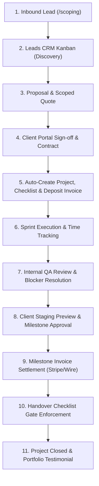

# PORTAL_GUIDE.md — Three-Sided Operations Platform Guide

**Platform:** The Flow Labs Studio OS (`theflowlabs.online`)  
**Architecture:** Single Data Model, Three Role-Segregated Views (`Admin`, `Team Member`, `Client`)  
**Stack:** Next.js 15, Tailwind CSS, Supabase PostgreSQL with Row Level Security (RLS), Vercel Serverless.

---

## 1. Portal Overview & Access Credentials

| Portal | URL Path | Intended Audience | Access Control |
|---|---|---|---|
| **Admin Portal (Flow HQ)** | [`/flow-hq`](https://www.theflowlabs.online/flow-hq) | Founders & Studio Admins (`owner`, `admin`) | Supabase Auth Email + Password (`profiles.role IN ('owner', 'admin')`). Unrestricted access to finance, leads, client accounts, payouts, and project management. |
| **Team Member Cockpit** | [`/flow-hq`](https://www.theflowlabs.online/flow-hq) | Software Engineers & Designers (`manager`, `member`) | Supabase Auth Email + Password (`profiles.role IN ('manager', 'member')`). Scoped strictly to assigned projects, personal timesheet stopwatch, QA review submissions, and blocker alerts. No access to studio finance or team pay. |
| **Client Portal** | [`/client`](https://www.theflowlabs.online/client) | Customers & Founders of Client Orgs (`client`) | Supabase Auth Email + Password (`profiles.role = 'client'`). Scoped strictly to own projects, proposal sign-off, milestone invoices, deliverables vault, onboarding checklist, and support tickets. |

### Default Seeded Credentials
- **Admin:** `theflowlabs01@gmail.com` (or any studio owner account)
- **Team Member:** `biswashpanda25@gmail.com`
- **Client:** `rohan@droovee.in` (Password: `flowlabs2026` or provisioned password)

---

## 2. End-to-End Pipeline & Lifecycle Walkthrough

### Stage 1: Lead Intake & Discovery
1. Prospective client completes the scoping intake on the website.
2. Inbound lead immediately arrives in **Flow HQ $\to$ Leads & Quotes** (`/flow-hq`).
3. Admin moves the lead across the Kanban pipeline: `New Intake` $\to$ `Contacted & Discovery`.

### Stage 2: Proposal Builder & Scoped Quote
1. Admin clicks **"Quote"** on the lead card or clicks **"Create Proposal"**.
2. Fills in project title, currency, scope, and itemized deliverables with estimated hours and rates.
3. Sets terms: 50% advance deposit upon acceptance, Net 14.
4. Proposal is generated and visible in the client portal.

### Stage 3: Client Sign-off & Auto-Provisioning
1. Client logs in to [`/client`](https://www.theflowlabs.online/client) and navigates to **"Proposals & Contracts"**.
2. Client reviews scope, itemized deliverables, and total investment.
3. Client inputs authorized signatory name and clicks **"Digitally Sign & Accept Proposal"**.
4. **Triggered Automation:**
   - Proposal marked `accepted` with timestamp and signatory name.
   - Associated lead marked `won`.
   - Studio project is automatically created with initial sprint milestones.
   - Client onboarding checklist is initialized with default criteria.
   - Advance deposit invoice (e.g. 50%) is automatically generated in `invoices`.

### Stage 4: Onboarding Checklist & Project Kickoff
1. Client accesses **"Onboarding Checklist"** in their portal:
   - Brand Assets & Vector Logos
   - Domain & Hosting Access Credentials
   - Third-Party API Keys (Stripe, OpenAI, Supabase)
   - Primary Decision Maker Confirmation
2. Client checks off items as they provide access.

### Stage 5: Engineering Execution & Time Tracking
1. Engineers log into [`/flow-hq`](https://www.theflowlabs.online/flow-hq).
2. Engineers view assigned sprint tasks under **"Tasks"**.
3. **Live Task Stopwatch:** Engineers navigate to **"Time Tracking"**, select their active task, and start the timer.
4. On stop, elapsed hours and work description are permanently recorded in `time_logs`.
5. **Flagging Blockers:** If a dependency or missing API key blocks progress, the engineer clicks **"Flag Blocker"**. An amber alert pill appears across the task matrix and admin is alerted.
6. **QA Review:** When work is complete, the engineer clicks **"QA Review"**, adds staging deliverable links and testing notes, and assigns a designated reviewer.

### Stage 6: Client Review & Milestone Invoicing
1. Client navigates to **"Sprint Overview"** in the Client Portal to inspect live staging builds.
2. Client clicks **"Approve Milestone"**.
3. Admin navigates to **"Finance & Invoicing"** to verify milestone progress and dispatch invoices.
4. Client navigates to **"Invoices & Billing"** to inspect invoice line items and settle payment via online checkout or bank wire.
5. Admin records verified transaction; invoice status transitions to `paid`.

### Stage 7: Handover Gate & Project Closure
1. When all sprint deliverables are finished, admin navigates to **"Projects"** and clicks **"Handover Gate"**.
2. The system enforces 5 mandatory criteria before allowing closure:
   - Production Deployment & DNS switch completed
   - Admin credentials & password transfer securely shared
   - Code repository ownership transferred
   - Walkthrough video & technical documentation shared
   - Final invoice settled and receipt issued
3. Once all 5 criteria are verified, the project is marked `completed` and archived.
4. Client submits a 5-star rating and testimonial in the Client Portal under **"Testimonial"**.

---

## 3. Security, RLS & Role Isolation Guarantees

1. **Database Row Level Security (RLS):**
   - Active on all 33 public tables (`proposals`, `contracts`, `invoices`, `payments`, `expenses`, `time_logs`, `team_payouts`, `tickets`, `handover_checklists`, `testimonials`).
   - `is_admin()` checks both `profiles.role IN ('owner', 'admin')` and `profiles.status = 'active'`. Suspended accounts lose access immediately.
   - Team members are physically restricted to queries where `member_id = auth.uid()` or project membership exists.
   - Clients are physically restricted to queries where `client_id = auth.uid()`.
2. **Serverless Execution:**
   - All privileged operations (user creation via Supabase Admin API, proposal acceptance, payment recording, and project closure) run in serverless API routes (`/api/operations`, `/api/onboard`) using the encrypted service key on the server.
3. **Audit Log:**
   - Every deletion, role change, and project handoff writes an entry to `audit_log`.
